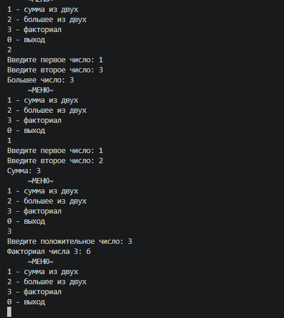
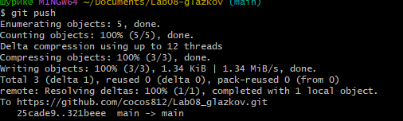

# Практическая работа №8

**ФИО: Глазков Александр**
**Группа: ИСП-242**
**Дата: 09.11.2026**

## Что изучено

- Чем `void` отличается от `return`: первый просто делает действие, второй возвращает результат.
- Как передавать данные в метод через параметры.
- Зачем выносить повторяющийся код в метод — чтобы не копировать одно и то же.

## Скриншоты

